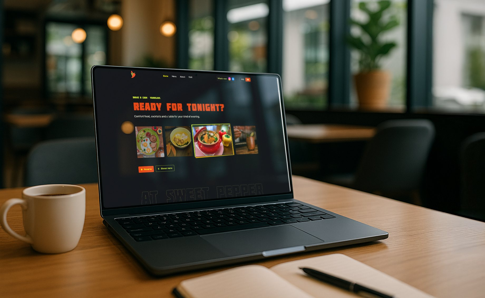

<a href="https://sweetpepper.bar/en/"></a>

# Sweet Pepper

The brand and website system for Sweet Pepper, a gastrobar in Yaroslavl open from breakfast to late-night cocktails. The site follows the guest’s time of day, from a mild breakfast to a late-night party. This repo holds the website, the system and the live style guide behind it. The [case study](https://www.conceptly.design/case/sweet-pepper) has the full story.

[Live site](https://sweetpepper.bar/en/) · [Style guide](https://sweetpepper.bar/style-guide.html) · [Case study](https://www.conceptly.design/case/sweet-pepper)

## The system

| Ramp | Tokens |
|---|---|
| Red · Chili |    |
| Green · Lime |      |
| Yellow · Lemon |   |
| Neutrals |    |

- **Type:** Molot for short all-caps headlines; Golos Text for body, menus and UI.
- **Spacing:** edges, gaps and icon sizes in multiples of 4px.
- **Day and night:** a light kitchen mode and a dark bar mode, with contrast checked in both.
- **Photography:** shot in the bar, warm directional light, shallow depth of field.

## The live style guide

**`style-guide.html`** is the guide the team opens on their phones, in English and Russian. Add `?edit` to the URL and every text block becomes editable; Save commits the change to this repo through the GitHub API, and the server picks it up within minutes. Layout, swatches and logos stay locked.

## What’s in this repo

```
sweet-pepper-theme/  the WordPress theme: PHP templates, SCF fields, Vite build
design.md            the system spec: tokens and rules, every change dated
website-brief.md     website decisions: day and night, page loader, pages
style-guide.html     the live style guide (EN/RU)
style-guide-edit.js  in-page edit mode, saved by style-guide-save.php
design/              colour, fonts, icons, logos
team-docs/           design guide for the team (EN/RU)
tools/               PDF renderer and translations
```

## How it was made

I was the bar’s graphic designer for years; in 2026 the owner came back for a website. I rebuilt the brand system first, designed the site in Figma and built it with an AI coding assistant. `design.md` is the record every session starts from: 42 commits and 10,000 words since September, each change dated and explained.

---

<sub>© Etual Fomina and Sweet Pepper. The logo, photos and texts are not for reuse.</sub>
